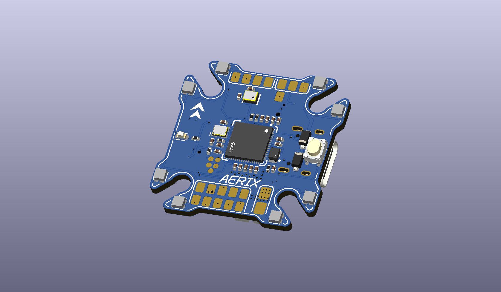
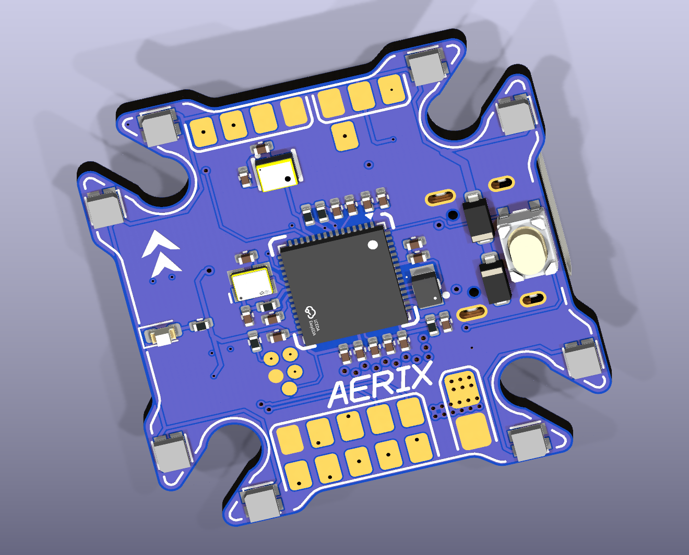
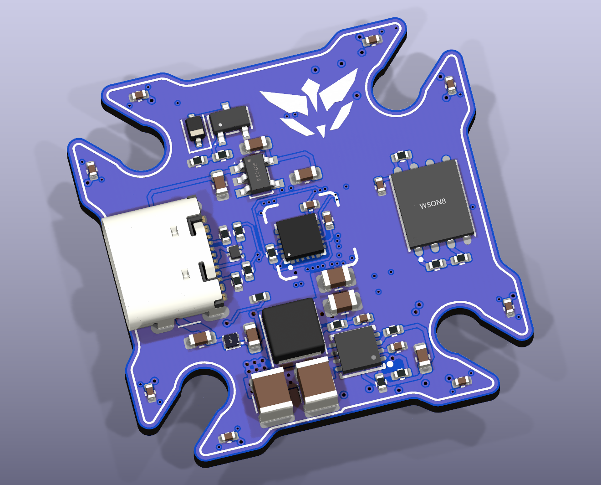
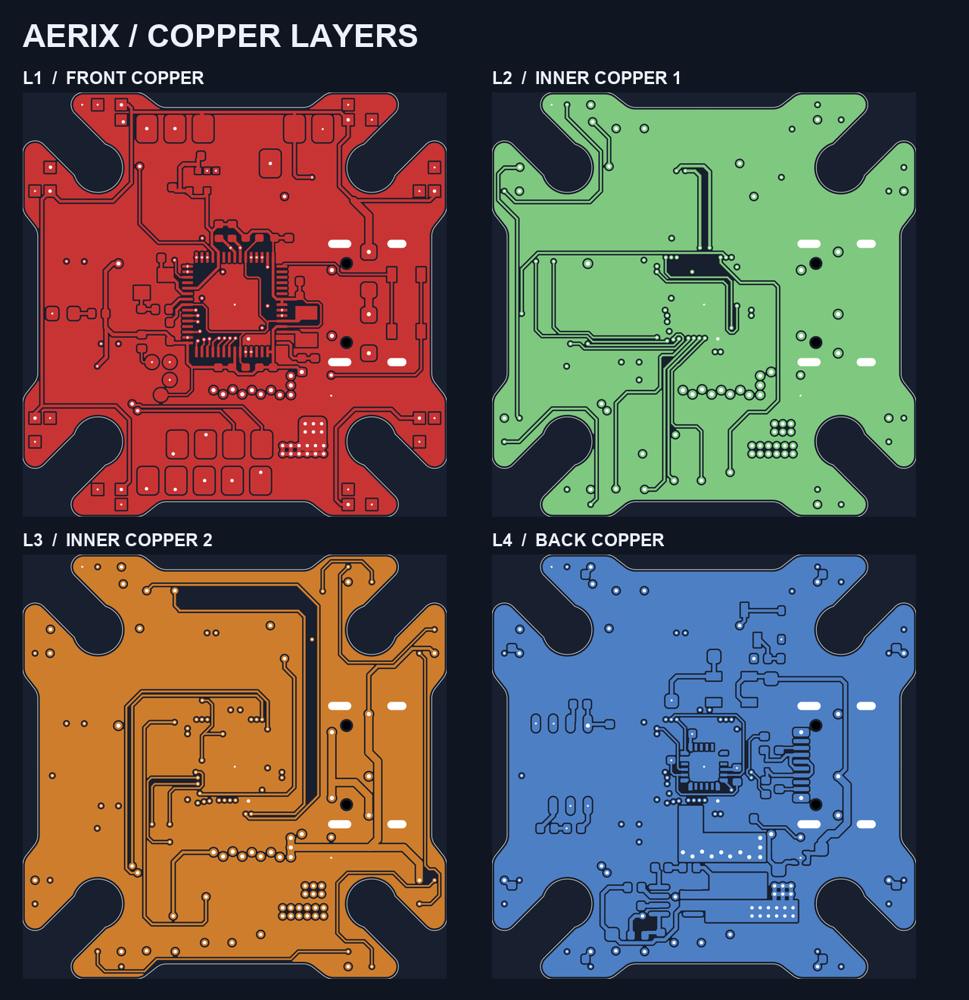
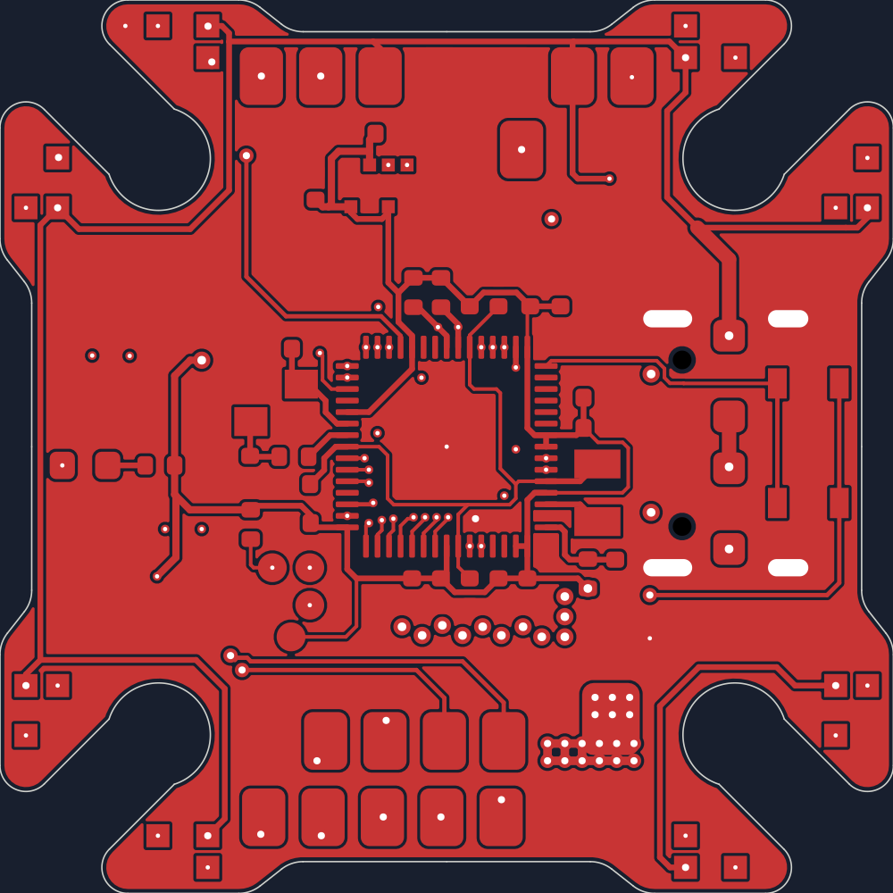
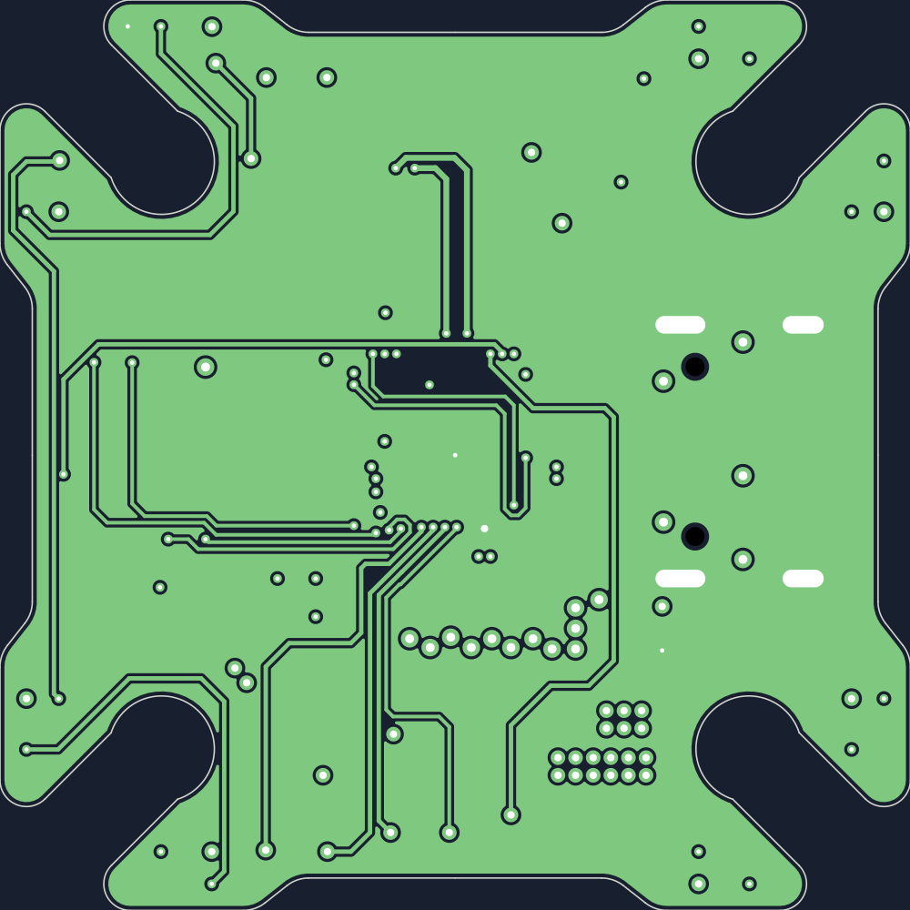
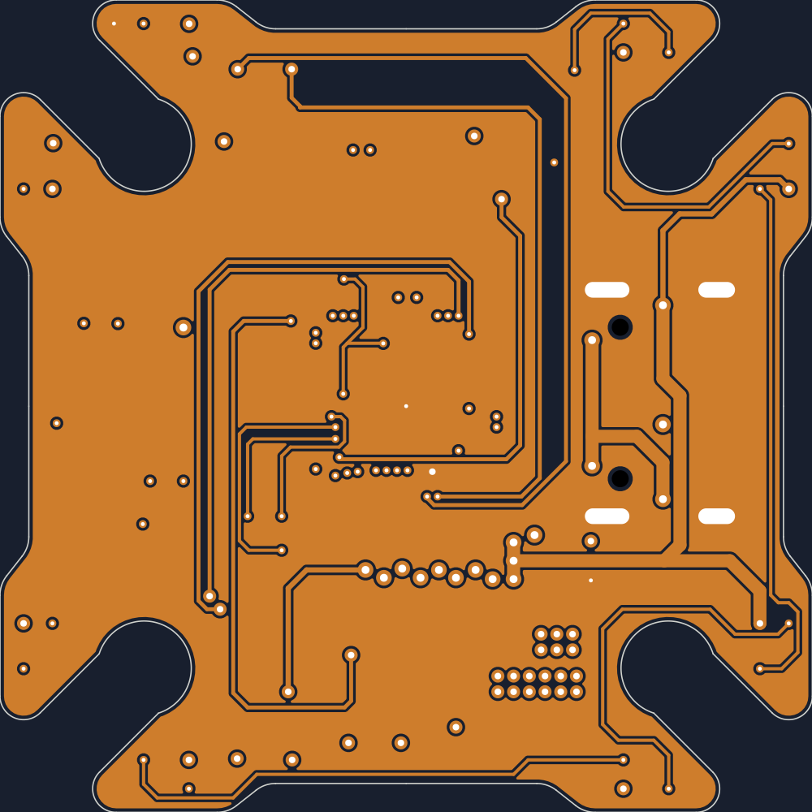
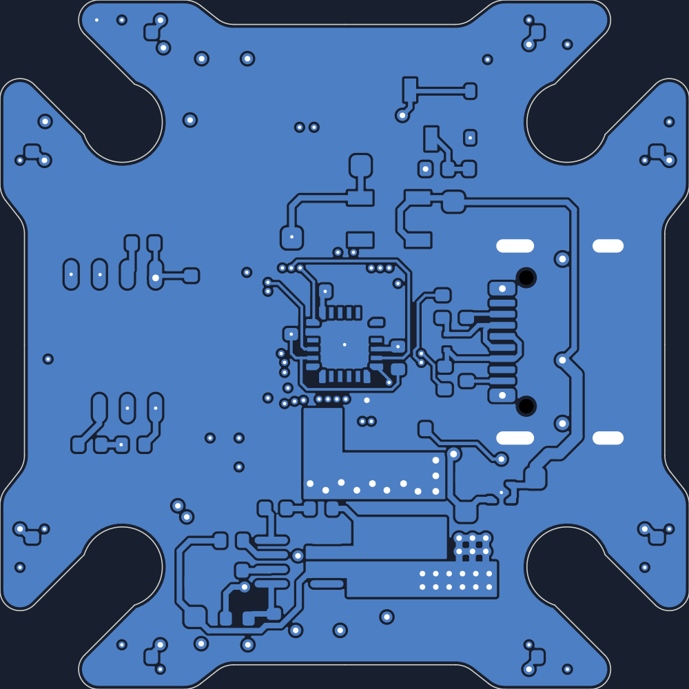

# **AERIX**

i wanted to design my own flight controller for fpv racing, so i made aerix. it fits a 20×20 mm stack and runs on an rp2354a with an icm-40609-d gyro.

i went with solder pads for the esc, receiver and vtx to keep the board small. the 8 rgb leds around the corners are there because they look cool af.

## front and back

| front | back |
| :---: | :---: |
|  |  |

## copper layers

see each layer up close

| front copper | inner copper 1 |
| :---: | :---: |
|  |  |

| inner copper 2 | back copper |
| :---: | :---: |
|  |  |

## files

- [kicad project](hardware/fc-v1/fc-v1.kicad_pro)
- [gerbers and drill files](hardware/production/fc-v1/fc-v1.zip)
- [interactive BOM](hardware/production/fc-v1/ibom.html) (download and open in a browser)

## bill of materials

| ref | part | qty |
| --- | --- | ---: |
| U1 | RP2354A microcontroller | 1 |
| U3 | ICM-40609-D gyro | 1 |
| U4 | W25Q128JVPIQTR flash | 1 |
| U5 | MP9943GQ-Z 5 V regulator | 1 |
| J1 | USB4105-GF-A USB-C port | 1 |
| LED10–LED17 | WS2812B-2020-V6 RGB LEDs | 8 |
| U2 | DPS368 barometer (optional) | 1 |

[full parts list with quantities and supplier links](hardware/production/fc-v1/aerix-bom.csv)
